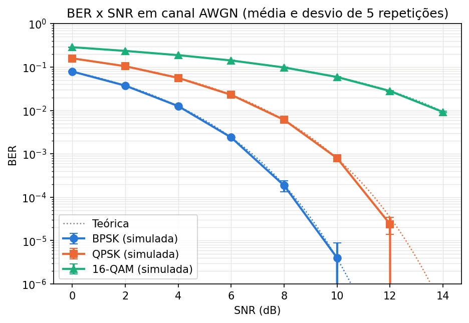
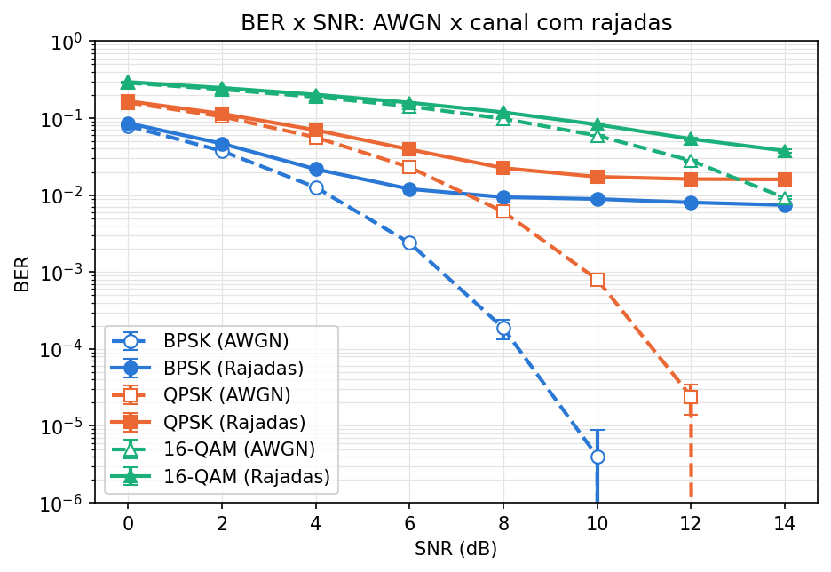
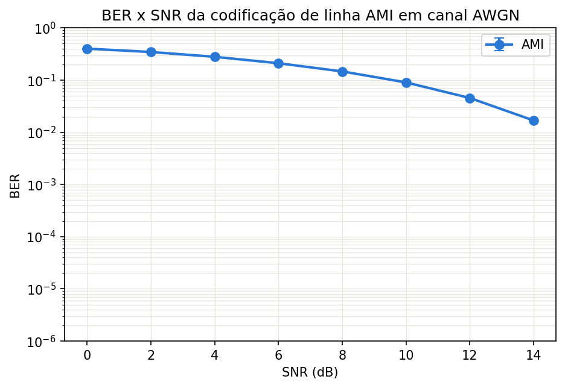

# Trabalho do Grau B (Redes de Computadores)

Simulador de comunicação digital desenvolvido em Python para a disciplina de Redes de Computadores.

## Apresentação

Acesse a apresentação de slides e o vídeo de execução do programa pelo link: https://canva.link/8035ectvmfg9dlh

## Arquitetura do Sistema

O fluxo de simulação segue as etapas principais de um enlace digital:
1. **Geração de Dados:** Conversão de mensagens ASCII para sequências binárias e geração de massa de dados aleatória (100.000 bits) para análise estatística.
2. **Codificação de Linha:** Transformação dos bits em níveis de tensão utilizando as técnicas **Manchester** e **AMI** (*Alternate Mark Inversion*).
3. **Modulação Digital:** Mapeamento do sinal em portadoras utilizando **BPSK**, **QPSK** e **16-QAM**.
4. **Canal Ruidoso:** Simulação de canal **AWGN** com controle de Relação Sinal-Ruído (SNR) e segundo cenário de degradação (ruído em rajadas).
5. **Recepção e Métricas:** Demodulação, detecção por limiar, reconstrução da mensagem, cálculo da **BER** e análise de **Eficiência Espectral**.

---

## Divisão de Responsabilidades da Dupla

### Integrante 1 — Bianca da Silva Franzon
* **Geração de Dados:** Implementação da conversão de strings ASCII para sequências binárias e geração de amostras de 100.000 bits.
* **Codificação de Linha:** Implementação das codificações Manchester e AMI (com alternância de polaridade para eliminação de componente DC).
* **Modelagem de Canal e Métricas:** Desenvolvimento do canal ruidoso AWGN com variação em 8 níveis de SNR, execução das 5 repetições aleatórias por ponto, cálculo da BER média e desvio padrão, e exportação dos resultados brutos para `resultados_ber.csv`.

### Integrante 2 — João Fidelis
* **Modulações Digitais:** Implementação das modulações e demodulações **BPSK**, **QPSK** e **16-QAM**.
* **Segundo Cenário e Eficiência Espectral:** Modelagem do canal com ruído em rajadas e cálculo da eficiência espectral nominal bits/s/Hz.
* **Análise Visual e Documentação Final:** Geração das curvas comparativas de BER X SNR com barras de erro a partir dos dados brutos, montagem da tabela de compromisso e gravação do vídeo demonstrativo.

---

## Parâmetros Experimentais Adotados

* **Volume de Transmissão:** 100.000 bits por ensaio.
* **Faixa de SNR (AWGN):** 0, 2, 4, 6, 8, 10, 12 e 14 dB (8 pontos).
* **Repetições Estatísticas:** 5 execuções independentes por nível de SNR para cálculo de média e variabilidade (desvio padrão).
* **Semente Aleatória Base:** `seed = 42` para reprodutibilidade dos experimentos.
* **SNR nas modulações:** potência média do símbolo dividida pela potência do ruído (Es/N0). As três constelações têm potência média 1 e passam pelo mesmo canal, então a comparação usa a mesma potência de sinal e a mesma banda.
* **Mapeamento:** Gray nas três modulações, com demodulação por limiar em cada eixo.
* **Canal com rajadas:** AWGN na SNR configurada mais rajadas de ruído. Cada símbolo inicia uma rajada com probabilidade 0,005, a rajada dura 20 símbolos e soma um ruído com a mesma potência do sinal. Cerca de 9,5% dos símbolos ficam dentro de alguma rajada.
* **Eficiência espectral nominal:** log2(M) bits/s/Hz, considerando banda igual à taxa de símbolos (Nyquist).

---

## Arquivos do Repositório

| Arquivo | Conteúdo |
|---|---|
| `algoritmoConversao.py` | Codificação de linha AMI, canal AWGN e BER. Gera `resultados_ber.csv`. |
| `modulacoes.py` | Modulação e demodulação BPSK, QPSK e 16-QAM, canal AWGN, canal com rajadas e teste com a mensagem ASCII. Gera `resultados_modulacoes.csv`. |
| `graficos.py` | Lê os dois CSVs e gera os gráficos da pasta `graficos/` e a `tabela_compromisso.md`. |
| `resultados_ber.csv` | Resultados da AMI: média e desvio padrão da BER por SNR. |
| `resultados_modulacoes.csv` | Resultados brutos das modulações: uma linha por modulação, canal, SNR e repetição (240 ensaios de 100.000 bits). |

---

## Como Instalar e Executar

### 1. Pré-requisitos
Certifique-se de ter o **Python 3** instalado juntamente com as bibliotecas `numpy` e `matplotlib`:

```bash
pip install numpy matplotlib
python algoritmoConversao.py   # AMI em AWGN, gera resultados_ber.csv
python modulacoes.py           # teste com a mensagem e BER das modulações, gera resultados_modulacoes.csv
python graficos.py             # gráficos e tabela de compromisso a partir dos CSVs
```
Ou execute pelo próprio VsCode

Com a semente fixa, cada execução reproduz exatamente os mesmos números e gráficos.

---

## Resultados

### Teste de consistência com a mensagem ASCII

`modulacoes.py` converte a mensagem em bits, transmite nas três modulações e reconstrói o texto, listando a posição dos bits incorretos (caracteres não imprimíveis aparecem como `?`):

```
Mensagem enviada (640 bits): "Redes de Computadores, Unisinos 2026/2. Trabalho do Grau B: BPSK, QPSK e 16-QAM."

Canal ideal
  BPSK   "Redes de Computadores, Unisinos 2026/2. Trabalho do Grau B: BPSK, QPSK e 16-QAM."
         bits incorretos: 0
  QPSK   "Redes de Computadores, Unisinos 2026/2. Trabalho do Grau B: BPSK, QPSK e 16-QAM."
         bits incorretos: 0
  16-QAM "Redes de Computadores, Unisinos 2026/2. Trabalho do Grau B: BPSK, QPSK e 16-QAM."
         bits incorretos: 0

AWGN 30 dB
  BPSK   "Redes de Computadores, Unisinos 2026/2. Trabalho do Grau B: BPSK, QPSK e 16-QAM."
         bits incorretos: 0
  QPSK   "Redes de Computadores, Unisinos 2026/2. Trabalho do Grau B: BPSK, QPSK e 16-QAM."
         bits incorretos: 0
  16-QAM "Redes de Computadores, Unisinos 2026/2. Trabalho do Grau B: BPSK, QPSK e 16-QAM."
         bits incorretos: 0

Rajadas 30 dB
  BPSK   "Redes d-0?omputadores, Unysinos 2026/2. Trabalho do Grau B: BPSK, QPSK e0?r-?AM."
         bits incorretos: 12 [57, 60, 67, 72, 74, 203, 579, 584, 588, 593, 597, 609]
  QPSK   "Redes de C??pupadorL[??Unisinos 2026/2. Trabalho do Grau B: BPSK, QPSK e 16-QAM."
         bits incorretos: 13 [80, 83, 84, 86, 88, 117, 154, 156, 159, 162, 164, 170, 178]
  16-QAM "Redes de Computadores, Unisinos 2026/2. Trabalho do Grau,B? ???K$ 1PSK e 16-QAM."
         bits incorretos: 13 [452, 453, 466, 481, 485, 488, 491, 496, 497, 501, 516, 529, 530]

AWGN 14 dB
  BPSK   "Redes de Computadores, Unisinos 2026/2. Trabalho do Grau B: BPSK, QPSK e 16-QAM."
         bits incorretos: 0
  QPSK   "Redes de Computadores, Unisinos 2026/2. Trabalho do Grau B: BPSK, QPSK e 16-QAM."
         bits incorretos: 0
  16-QAM "Vedes de Comp5ta$ores, Unisinms 2026/2. Traba?ho do Grau B: BPSK, QPSK e 16-QAM."
         bits incorretos: 5 [5, 105, 129, 238, 360]

Rajadas 14 dB
  BPSK   "Redes `e Computado?as, Unisinos 2026/2. Trabalho do Grau B: BPSK, QPSK e 16-QAM."
         bits incorretos: 3 [53, 144, 157]
  QPSK   "RedeC(DgfComputadores, Unisinos 2026/2. Trabpo`?`do Grau B: BPSO/??P?J6%`16-QAM."
         bits incorretos: 32 [34, 35, 44, 50, 62, 65, 69, 70, 355, 359, 366, 367, 372, 379, 385, 509, 518, 519, 520, 523, 524, 528, 545, 547, 548, 549, 559, 563, 565, 566, 569, 577]
  16-QAM "Redes dm Computadores, UniSifos !T&3^R? ??abalho do Grau B: BPSK, QPSK e 16-QQM."
         bits incorretos: 29 [60, 210, 228, 259, 262, 263, 265, 266, 269, 275, 277, 285, 287, 289, 290, 291, 295, 297, 298, 304, 305, 307, 309, 320, 325, 327, 328, 329, 619]
```

No canal ideal e em AWGN com 30 dB as três modulações recuperam a mensagem sem nenhum bit incorreto, o que valida a cadeia modulação, canal e demodulação. As divergências aparecem em dois casos:

* **AWGN com 14 dB:** só a 16-QAM erra, com 5 bits isolados. É o esperado para a BER medida nessa SNR (9,2 × 10⁻³ em 640 bits, cerca de 6 erros).
* **Canal com rajadas:** há erros mesmo com 30 dB, porque o ruído da rajada não depende da SNR configurada. Os bits incorretos ficam agrupados em posições vizinhas, corrompendo caracteres seguidos, enquanto o resto da mensagem chega intacto.

### BER x SNR em canal AWGN



Cada ponto é a média de 5 repetições de 100.000 bits e a barra é o desvio padrão entre as repetições. As linhas pontilhadas são as curvas teóricas, e a simulação segue a teoria nas três modulações.

* Para a mesma SNR, a BPSK tem a menor BER, seguida da QPSK e da 16-QAM. Pela curva teórica, a BER de 10⁻³ exige 6,8 dB na BPSK, 9,8 dB na QPSK e 16,5 dB na 16-QAM.
* A QPSK precisa de 3 dB a mais que a BPSK porque divide a mesma potência entre dois bits por símbolo. Em energia por bit (Eb/N0) as duas são equivalentes.
* **Variabilidade:** enquanto a BER está acima de 10⁻³, cada ensaio tem centenas ou milhares de erros e o desvio fica abaixo de 4% da média. Com poucos erros a variação relativa cresce: 28% na BPSK em 8 dB (9 a 23 erros por ensaio) e maior que a média na BPSK em 10 dB (2 erros em 500.000 bits), por isso a barra inferior desse ponto vai até a base do gráfico.
* A BPSK em 12 e 14 dB e a QPSK em 14 dB não tiveram nenhum erro nas 5 repetições, então esses pontos não aparecem no eixo logarítmico. Com 100.000 bits, a menor BER mensurável por ensaio é 10⁻⁵.

### AWGN x canal com rajadas



* Em SNR baixa as curvas dos dois canais quase coincidem, porque o ruído AWGN domina (BPSK em 0 dB: 7,9 × 10⁻² em AWGN e 8,6 × 10⁻² com rajadas).
* Em SNR alta a BER com rajadas para de cair e forma um patamar: em 14 dB a BPSK fica em 7,4 × 10⁻³ e a QPSK em 1,6 × 10⁻², contra zero erros em AWGN. A 16-QAM fica em 3,8 × 10⁻², quatro vezes a BER em AWGN.
* Aumentar a potência do sinal não resolve esse canal, porque os erros vêm das rajadas e não do ruído de fundo. Como os erros chegam agrupados, a solução adequada é um código corretor de erros com entrelaçamento.
* A 16-QAM é a mais afetada, porque seus pontos ficam mais próximos na constelação e a mesma rajada de 20 símbolos atinge 80 bits (20 na BPSK e 40 na QPSK).
* A variabilidade entre repetições também é maior com rajadas (até 8% da média), porque a quantidade de rajadas muda de um ensaio para outro.

### Tabela de compromisso entre BER e eficiência espectral

| Modulação | Eficiência espectral nominal (bits/s/Hz) | BER AWGN 6 dB | BER AWGN 10 dB | BER AWGN 14 dB | BER Rajadas 14 dB | Menor SNR testada com BER ≤ 10⁻³ (AWGN) |
|---|---|---|---|---|---|---|
| BPSK | 1 | 2.39e-03 | 4.00e-06 | 0.00e+00 | 7.41e-03 | 8 dB |
| QPSK | 2 | 2.30e-02 | 7.96e-04 | 0.00e+00 | 1.60e-02 | 10 dB |
| 16-QAM | 4 | 1.42e-01 | 5.90e-02 | 9.21e-03 | 3.76e-02 | acima de 14 dB |

Ganhar eficiência espectral custa SNR: cada modulação transmite mais bits na mesma banda, mas exige um canal melhor para manter a mesma BER.

* **BPSK:** mais adequada para canais com SNR baixa ou quando a confiabilidade importa mais que a taxa. Atinge BER de 10⁻³ a partir de 8 dB, mas usa 1 bit/s/Hz.
* **QPSK:** dobra a taxa na mesma banda com 3 dB a mais de SNR. É o melhor equilíbrio para SNR a partir de 10 dB.
* **16-QAM:** quadruplica a taxa da BPSK, mas só é viável com SNR alta (cerca de 16,5 dB para BER de 10⁻³, fora da faixa testada) ou combinada com correção de erros. É indicada para canais bons com banda limitada.

### Codificação de linha AMI



Curva gerada a partir de `resultados_ber.csv`, com a média e o desvio padrão das 5 repetições da AMI em AWGN.

### Codificação de linha x codificação de correção de erros

A codificação de linha define como cada bit vira um nível de tensão no meio físico (AMI, Manchester) e cuida de sincronismo de relógio e de componente DC, sem acrescentar proteção contra erros. A codificação de correção de erros (por exemplo, Hamming) acrescenta bits redundantes aos dados para que o receptor detecte e corrija bits trocados pelo ruído. As duas são complementares: a correção de erros atua sobre os bits antes da transmissão e a codificação de linha atua sobre o sinal.